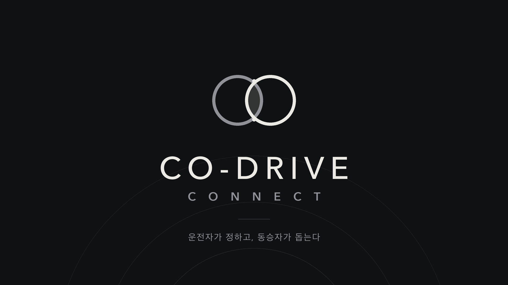

# CO-DRIVE CONNECT

차량에 설치한 CO-DRIVE 앱의 QR 코드로 동승자가 앱 설치 없이 휴대폰 웹에 접속하고, 운전자가 승인한 역할 범위 안에서 지도·공조·조명·음악 기능을 요청하는 서비스.

```
휴대폰 웹 ──WebSocket──▶ Spring Boot 서버 ──WebSocket──▶ 차량 Android 앱 ──▶ Pleos SDK (또는 Mock)
(Thymeleaf)              (권한 검증·세션·감사)             (VehicleGateway)
```

| 폴더 | 내용 |
|---|---|
| `codrive-server/` | Java 21, Spring Boot 3.3, Security, WebSocket, JPA, Flyway, PostgreSQL, Thymeleaf |
| `codrive-vehicle/` | Java Android 앱 (XML, MVVM, OkHttp WebSocket, Android Keystore, Pleos Vehicle 2.3.2 / NaviHelper 3.0.5) |
| `docker-compose.yml` | 로컬 개발용 PostgreSQL + 서버 |

## 시연 영상

[assets/CO-DRIVE_CONNECT_demo.mp4](assets/CO-DRIVE_CONNECT_demo.mp4): Pleos Connect 에뮬레이터의 차량 화면과 동승자 휴대폰 웹을 나란히 녹화했다(① 음악: QR 참여 → 승인 → 역할 → 제어 권한 → 재생·다음 곡·일시정지, ② 내비게이션: 목적지 검색·제안 → 운전자 수락 → 차량 내비 안내 시작). 단계별 화면은 `assets/screenshots/` 에 있다(`web-flow.png`·`car-flow.png`: 음악, `web-flow-map.png`·`car-flow-map.png`: 내비게이션, `web/`·`car/`: 원본).

## 실행

```bash
docker compose up -d db

cd codrive-server
PUBLIC_BASE_URL=http://localhost:8080 GEOCODING_ENABLED=false ./gradlew bootRun
# 모바일 웹: http://localhost:8080/join

cd codrive-vehicle && ./gradlew :app:assembleDebug
```

- 에뮬레이터는 호스트를 `10.0.2.2` 로 본다. 서버 주소와 모드(MOCK / PLEOS)는 앱의 설정에서 바꾼다.
- `PUBLIC_BASE_URL` 은 QR 에 들어가는 주소다. 실제 휴대폰이 접속할 수 있는 주소(HTTPS 권장)여야 한다.
- 릴리스 빌드는 HTTPS/WSS 만 허용하고 개발용 설정 화면이 없다. 서버 주소는 `-PcodriveServerUrl=https://...`, 서명은 `-PRELEASE_STORE_FILE`, `-PRELEASE_STORE_PASSWORD`, `-PRELEASE_KEY_ALIAS`, `-PRELEASE_KEY_PASSWORD` 로 지정한다.
- 목적지 검색은 OpenStreetMap Nominatim 을 쓴다(`GEOCODING_ENABLED=true`). 이용 정책상 `GEOCODING_USER_AGENT` 에 연락처를 넣는다.
- PLEOS 모드는 Pleos Connect 전용 AVD(Android Emulator 37.2.13 이상)에서 실행한다. 에뮬레이터의 Virtual Console 이 열려 있어야 SET 이 반영된다.

## 테스트

```bash
cd codrive-server  && ./gradlew test
cd codrive-vehicle && ./gradlew :app:testDebugUnitTest
```

서버 35개(H2 PostgreSQL 모드, 실제 WebSocket 통합 테스트 포함), 차량 앱 20개.

## 동작 방식

1. 차량 앱을 실행하면 QR 과 참여 코드가 나온다. 일회용이며 5분 뒤 만료된다.
2. 동승자가 QR 을 스캔하고 닉네임을 입력해 참여를 요청한다.
3. 운전자가 승인하고 역할(지도 / 공조 / 조명 / 음악)을 배정한다.
4. 값을 바꾸는 제어 기능은 기능별로 운전자가 따로 켠다. 켜지 않으면 조회와 지도 요청만 가능하다.
5. 동승자가 요청하면 차량 앱이 SDK 로 적용하고, 값을 다시 읽어 확인한 뒤 결과를 알린다.

## 정책

- **자동 복원 금지**: 차량 앱이 완전히 다시 시작되면(`launchId` 변경) 이전 세션·QR·권한을 모두 폐기한다. 같은 프로세스에서 화면만 나갔다 돌아오면 같은 세션을 돌려준다.
- **승인과 제어 권한 분리**: 참여 승인과 역할 배정 후에도 제어 기능은 운전자가 기능별로 켠다.
- **목적지는 제안 → 수락 → 적용**: 동승자의 목적지·경유지는 운전자가 수락해야 내비에 전달된다. 응답이 없으면 만료된다.
- **적용 확인**: `APPLIED` 는 SDK 응답과 재조회로 확인한 경우에만 기록한다. Mock 결과는 `simulated=true` 로 전달되어 웹에 `MOCK` 으로 표시된다.
- **QR**: 일회용, 5분 만료, 동시에 유효한 QR 은 하나. 서버에는 SHA-256 해시만 저장한다. 차량 ID 는 휴대폰이 지정할 수 없다.
- **차량 인증**: 설치 시 Android Keystore 에 EC 키쌍을 만들고, 서버가 준 일회용 nonce 에 서명해 접속 토큰을 받는다.
- **네트워크 단절**: 하트비트와 유예시간(기본 30초). 유예 중에는 제어를 막고(`SESSION_SUSPENDED`), 넘기면 세션을 종료한다.
- **주행 중 제한**: `CarUxRestrictions` 로 판단한다. 주행 중에는 승인·역할·권한 변경 버튼을 막고, 상태를 알 수 없으면 주행 중으로 본다.
- **음악**: 차량 앱이 직접 재생한다(`InAppMusicPlayer`, `MediaPlayer` + 오디오 포커스). 동승자의 재생·일시정지·이전·다음 요청은 재생 상태와 곡 제목을 다시 읽어 확인한 뒤 적용 완료로 알린다. 기본 수록곡 3개는 직접 합성한 샘플이며 `codrive-vehicle/app/src/main/res/raw/` 의 파일을 바꾸면 교체된다. MOCK 모드의 음악은 소리 없이 시뮬레이션한다.

## API

시간은 ISO-8601(UTC). 오류는 `{ "error": "CODE", "message": "..." }`.

### 차량 앱 REST (`Authorization: Bearer <accessToken>`)

| 요청 | 설명 |
|---|---|
| `POST /api/vehicle/register` `{displayName, publicKey}` | 설치 등록. publicKey 는 EC(secp256r1) X.509 DER 의 Base64. → `{installationId}` |
| `POST /api/vehicle/challenge` `{installationId}` | 일회용 nonce(60초) |
| `POST /api/vehicle/verify` `{installationId, nonce, signature}` | `SHA256withECDSA(nonce)` 검증 → `{accessToken}`(12시간) |
| `POST /api/vehicle/sessions/open` `{launchId}` | 같은 launchId 면 기존 세션, 아니면 이전 세션을 종료(`VEHICLE_RESTART`)하고 새로 만든다 |
| `GET /api/vehicle/sessions/{sid}/snapshot` | 화면용 전체 상태 |
| `POST /api/vehicle/sessions/{sid}/join-tokens` | 새 QR. 이전 미사용 QR 무효화. 3명이면 `409 FULL` |
| `POST .../requests/{rid}/approve` · `/reject` | 참여 승인 / 거절 (최대 3명) |
| `PUT .../participants/{pid}/role` `{role}` | 역할 배정. 기능 권한은 기본값으로 초기화 |
| `PUT .../participants/{pid}/permissions/{feature}` `{access: NONE\|VIEW\|CONTROL}` | 기능별 권한 |
| `DELETE .../participants/{pid}` | 연결 해제 |
| `POST /api/vehicle/sessions/{sid}/end` `{reason: USER_ENDED_ALL\|POWER_OFF}` | 세션 종료 |

### 동승자 REST (인증 없음, 속도 제한)

| 요청 | 설명 |
|---|---|
| `GET /join?token=` | 모바일 웹 |
| `GET /api/join/preview?token=\|code=` | 참여 가능 여부 |
| `POST /api/join/requests` `{token \| code, nickname}` | 참여 요청 → `{requestId, participantToken, sessionAlias}`. QR 은 이 시점에 소진된다 |
| `GET /api/places/search?q=` (`X-Participant-Token`) | 장소 검색(초당 1회) |

### WebSocket

메시지 형식은 `{ "type": "...", "payload": {...} }`.

`/ws/vehicle` (핸드셰이크에 Bearer 토큰)
- 차량→서버: `PING`, `CAPABILITY_REPORT`, `COMMAND_ACK`, `COMMAND_RESULT {requestId,status,errorCode,simulated,message}`, `VEHICLE_STATE`, `POWER_OFF`
- 서버→차량: `HELLO`, `PONG`, `SESSION_SNAPSHOT`, `JOIN_REQUEST`, `VEHICLE_COMMAND {requestId,action,params,from}`, `VEHICLE_STATE_REQUEST`, `SESSION_ENDED`

`/ws/participant` (연결 후 5초 안에 첫 메시지로 `AUTH {token}`)
- 휴대폰→서버: `AUTH`, `VEHICLE_COMMAND {action,params}`, `VEHICLE_STATE_REQUEST {domain}`, `LEAVE`, `PING`
- 서버→휴대폰: `AUTH_OK`, `STATE_UPDATE`, `JOIN_APPROVED`, `JOIN_REJECTED`, `ROLE_ASSIGNED`, `ROLE_UPDATED`, `ROLE_REVOKED`, `SESSION_SUSPENDED`, `VEHICLE_RECONNECTED`, `SESSION_ENDED`, `COMMAND_ACCEPTED`, `COMMAND_RESULT`, `VEHICLE_STATE`, `ERROR`

### 역할·기능·상태

- 역할: `MAP`, `HVAC`, `LIGHT`, `MUSIC`
- 기능 코드(명령의 `action` 과 동일): `NAV_DESTINATION`, `NAV_WAYPOINT`, `HVAC_VIEW`, `HVAC_TEMPERATURE`, `HVAC_FAN`, `LIGHT_VIEW`, `LIGHT_BRIGHTNESS`, `LIGHT_COLOR`, `MUSIC_VIEW`, `MUSIC_CONTROL`
- `MUSIC_CONTROL` params: `{ "command": "PLAY" | "PAUSE" | "NEXT" | "PREVIOUS" }`
- 기능 상태: `AVAILABLE`, `VIEW_ONLY`, `PERMISSION_REQUIRED`, `NOT_SUPPORTED`, `TEMPORARILY_BLOCKED`, `MOCK_ONLY`. 차량 쪽 제한이 운전자 부여보다 우선한다.
- 명령 상태: `RECEIVED → AUTHORIZED → SENT_TO_VEHICLE → APPLYING → APPLIED`, 또는 `FAILED`, `PERMISSION_DENIED`, `NOT_SUPPORTED`, `TIMED_OUT`, `DELIVERED`. `DELIVERED` 는 전달만 했고 결과를 확인할 수 없다는 뜻이며 적용 완료가 아니다.
- 세션 종료 사유: `VEHICLE_RESTART`, `USER_ENDED_ALL`, `POWER_OFF`, `NETWORK_TIMEOUT`, `EXPIRED`

## Pleos SDK

공개 Maven(`https://nexus-playground.pleos.ai/repository/maven-releases/`)의 AAR 을 받아 `javap` 로 실제 API 를 확인했다. Java 에서 호출할 수 있고, 콜백은 Kotlin `Function1/2` 다.

- 공조: `setHvacTemperature`, `getHvacTemperature`, `setHvacFanSpeed`, `getHvacFanSpeed`, `check*Capabilities`. 지원 범위와 영역은 하드코딩하지 않고 capability 가 보고한 값을 쓴다(풍량은 운전석 영역을 지원하지 않는다).
- 조명: `setAmbientLightBrightness`, `getAmbientLightBrightness`. 색상은 값의 의미를 확인하지 못해 실차 모드에서 `NOT_SUPPORTED` 로 보고한다.
- 내비: `NaviHelper.requestRoute`, `addWaypoint`. 위도·경도가 필수라 서버에서 장소 검색을 한다. 퍼미션 5종(`NAVI_ROUTE`, `NAVI_ROUTE_SEARCH`, `NAVI_CUSTOM_MAP`, `NAVI_CUSTOM_ROUTE`, `NAVI_CUSTOM_ETC`)을 선언한다.
- 제공 상태(2026-10-29 문서 기준): Vehicle State 조회와 NaviHelper 는 신청 없이 사용 가능, Vehicle Control·TTS·STT·FusedLocation 은 준비 중. 릴리스 빌드에는 제어 퍼미션을 선언하지 않았고, 시험용 `CONTROL_CAR_CLIMATE` 는 디버그 빌드에만 있다.
- 교훈: `set` 완료 콜백의 값은 요청한 값이지 새로 읽은 값이 아니므로 재조회로 확인한다. `initialize()` 직후에는 서비스에 연결되지 않았을 수 있어 몇 초 간격으로 다시 조회한다. 서비스는 수 초간 끊겼다 돌아올 수 있다.
- 주행 규제: `CarUxRestrictionsManager` 를 따른다. 앱이 DO(주행 중 사용 가능)를 선언하지 않았으므로 주행 중에는 플랫폼이 앱을 가린다.
- 제3자 앱의 음악을 제어하는 공식 API·퍼미션은 문서에 없다. 그래서 외부 앱을 조종하지 않고 앱이 직접 재생한다. 재생 전에 오디오 포커스를 요청하고, 포커스를 잃으면 멈추거나 볼륨을 낮춘다.

## 검증 현황

| 구분 | 내용 |
|---|---|
| 자동 테스트 | 20개 시나리오 중 대부분을 서버 통합 테스트와 앱 단위 테스트로 확인 (QR, 승인·역할, 권한 차단, 세션 격리, 재연결, 재시작 초기화, 토큰 무효화, Mock 구분) |
| PostgreSQL | postgres:16 에 Flyway 마이그레이션 적용, 서버 기동 확인 |
| Pleos 에뮬레이터 | v2.1 AVD 에서 PLEOS 모드로 공조 온도·풍량 읽기와 제어, 차량 HMI 값 변경 확인. NaviHelper 퍼미션 인식, 주행 시 플랫폼이 앱을 가리는 것 확인 |
| 서버 배포 | Docker 이미지와 `docker-compose.yml` 로 실행할 수 있도록 구성. 하위 경로(`/codrive`)로 배포하는 경우의 토큰 인증을 시험으로 확인 |

### 확인하지 못한 것
- 운전자 수락 후 실제 `NaviHelper.requestRoute` 결과 (제안·수락 UI 까지만 확인)
- 앰비언트 밝기 쓰기
- 앱 내 음악 재생: JVM 단위 테스트(재생목록)와 빌드만 확인. 에뮬레이터·실차에서 소리가 나는지, 포커스 동작은 아직 확인하지 못함
- 차량 앱의 전원 OFF 감지 (서버의 `POWER_OFF` 처리 경로만 구현)
- 휴대폰 실기기에서 카메라로 QR 을 스캔하는 과정, 프록시 뒤 WSS 연결
- 12.9"/14.6" 폼팩터, CCP Back 동작, 낮은 화면(약 390dp)에서 사용자 카드 하단이 잘려 스크롤이 필요한 점
- 서버 Docker 이미지의 단독 빌드, 다중 서버 인스턴스. 차량 토큰·nonce 는 서버 메모리에 있어 서버를 재시작하면 차량이 다시 인증한다
- 실차 제어: 제어 퍼미션은 Pleos 의 승인이 필요하다
